<div align="center">



# ⚡ Awesome File Synchronization 🔄

<a href="https://github.com/ishandutta2007/Awesome-Awesome-Awesome"></a><a href="https://discord.gg/jc4xtF58Ve"></a>
<a href="https://creativecommons.org/publicdomain/zero/1.0/"></a>
<a href="https://github.com/ishandutta2007/Awesome-File-Synchronization/pulls"></a>
<a href="https://github.com/ishandutta2007/Awesome-File-Synchronization/graphs/commit-activity"></a>
<a href="#-synchronization-architectures--selection-matrix"></a>
<a href="https://github.com/ishandutta2007"></a>

**The definitive curated directory of high-performance file synchronization engines, peer-to-peer (P2P) data replication tools, continuous mirroring utilities, and enterprise cloud sync platforms.**

*Optimized for developers, system administrators, DevOps engineers, and privacy-first self-hosters.*

[🌐 Sector Overview](#-sector-overview--market-dynamics) • [💼 SaaS & Enterprise](#-saas--commercial-file-synchronization-platforms) • [🔓 Open-Source Engines](#-open-source-github-projects) • [🏗️ Architectures](#-synchronization-architectures--selection-matrix) • [🤝 Contributing](#-how-to-contribute)

</div>

---

## 📖 Overview & SEO Summary

**File Synchronization** (*file sync*) ensures that files stored across two or more physical locations, local devices, servers, or cloud storage buckets remain identically updated according to predetermined replication rules. Whether implementing **real-time continuous bidirectional sync**, **delta-transfer incremental mirroring**, or **zero-trust peer-to-peer (P2P) mesh networking**, choosing the right synchronization stack eliminates data loss, mitigates vendor lock-in, and guarantees data availability across distributed environments.

### 🔑 Key Concepts Covered
- 🔄 **Continuous vs. Scheduled Synchronization**: Background filesystem watchers (`inotify`, `FSEvents`) vs. cron/periodic diff runs.
- ⚡ **Delta-Transfer & Block-Level Deduplication**: Algorithms transmitting only byte-level differences rather than entire modified files (e.g., `rsync` algorithm, CDC chunking).
- 🌐 **Peer-to-Peer (P2P) vs. Centralized Topology**: Device-to-device direct TLS transport without central third-party servers.
- 🛡️ **Zero-Knowledge Encryption (E2EE)**: End-to-end client-side cryptographic hashing for private off-site replication.
- 🔀 **Bidirectional Sync with Conflict Resolution**: Automated three-way merge resolution vs. manual interactive diff approval.

---

## 📑 Table of Contents
- [📊 Sector Overview & Market Dynamics](#-sector-overview--market-dynamics)
- [💼 SaaS & Commercial File Synchronization Platforms](#-saas--commercial-file-synchronization-platforms)
- [🔓 Open-Source GitHub Projects](#-open-source-github-projects)
- [🏗️ Synchronization Architectures & Selection Matrix](#-synchronization-architectures--selection-matrix)
- [🤝 How to Contribute](#-how-to-contribute)
- [💖 Support & Community](#-support--community)
- [⭐ Star History](#--star-history)
- [⚠️ Disclaimer & Data Safety](#️-disclaimer--data-safety)

---

## 📊 Sector Overview & Market Dynamics

The global **Enterprise File Synchronization and Sharing (EFSS)** and data replication software market is valued at approximately **$11.2 Billion** and is projected to expand to **$35.8 Billion by 2030**, representing a robust compound annual growth rate (**CAGR**) of **21.6%**. 

From a market dynamics perspective, the sector is **moderately fragmented**: while hyperscale cloud ecosystems (*Microsoft 365, Google Workspace, Dropbox, Box*) capture broad commodity office collaboration, a single winner-take-all monopoly does not exist. Instead, specialized niches remain highly competitive and defensible—notably hardware-coupled NAS synchronization (*Synology, QNAP*), high-throughput enterprise WAN replication (*PeerGFS, SureSync*), and privacy-centric peer-to-peer continuous replication (*Resilio, Syncthing*) where data sovereignty, zero-trust security, and bandwidth optimization prevent total cloud centralization.

---

## 💼 SaaS & Commercial File Synchronization Platforms

The following table compares leading commercial and SaaS file synchronization platforms, sorted in descending order by **Company Size (Revenue / Valuation)**.

| 🏢 Platform & Provider | 📈 Company Scale (Valuation / Revenue) | 💰 Starting Tier Price | 🎁 Free Tier / Trial Limit | ⚙️ Deployment & Sync Architecture |
| :--- | :--- | :--- | :--- | :--- |
| **[SyncToy (Microsoft)](https://www.microsoft.com/en-us/download/details.aspx?id=15155)** | **~$3,100B Valuation**<br>(~$245B ARR) | **$0.00**<br>(Free Utility) | **Free forever plan**<br>(Unlimited folder pairs; legacy Windows utility, discontinued by MS) | Local folder pairs, network drive shares, one-way echo and two-way sync |
| **[Dropbox](https://www.dropbox.com/)** | **~$8.5B Market Cap**<br>(~$2.5B ARR) | **$9.99 / month**<br>(Plus plan, 2 TB, billed annually) | **2 GB free forever**<br>(Capped at max 3 linked devices simultaneously on Basic) | Centralized cloud sync, LAN sync acceleration, block-level delta sync |
| **[Box](https://www.box.com/)** | **~$4.8B Market Cap**<br>(~$1.05B ARR) | **$10.00 / user / mo**<br>(Starter tier, 100 GB, min 3 users) | **10 GB free forever**<br>(Single user personal account; 250 MB max single file upload limit) | Cloud-first enterprise file sync, granular access governance, virtual drive mount |
| **[Egnyte](https://www.egnyte.com/)** | **~$3.0B Valuation**<br>(~$250M ARR) | **$20.00 / user / mo**<br>(Team Plan, up to 10 users) | **15-day free trial**<br>(Full enterprise features enabled, up to 10 users, 1 TB trial quota) | Hybrid cloud sync, local storage appliances caching, smart bandwidth throttling |
| **[Synology Drive](https://www.synology.com/en-us/drive)** | **~$2.0B Valuation**<br>(~$650M Revenue) | **$0.00 bundled**<br>(Hardware from $149.99 for BeeStation/DS124) | **Free forever bundled with NAS**<br>(Unlimited files/folders; concurrency capped by model hardware, 200–500 clients) | Private cloud hosted on Synology NAS, on-demand continuous sync, file versioning |
| **[Qsync (QNAP)](https://www.qnap.com/en/software/qsync)** | **~$1.0B Valuation**<br>(Parent: IEI, ~$350M Revenue) | **$0.00 bundled**<br>(Hardware from $179.00 for TS-133 NAS) | **Free forever bundled with NAS**<br>(Capped only by NAS storage; supports up to 32 paired folders per client) | Centralized private NAS synchronization, team folder sharing, subfolder selective sync |
| **[Resilio Sync](https://www.resilio.com/)** | **~$75M Valuation**<br>(~$25M ARR) | **$59.99 one-time**<br>(Home Pro lifetime license) | **Free forever basic plan**<br>(Direct P2P transfer; lacks selective sync, file permissions, and unified device profile) | Decentralized peer-to-peer (BitTorrent protocol), direct NAT traversal, WAN acceleration |
| **[PeerGFS (Peer Software)](https://www.peerglobal.net/)** | **~$60M Valuation**<br>(~$20M ARR) | **$2,500.00 / year**<br>(Base capacity block entry tier) | **30-day enterprise free trial**<br>(Full multi-site replication & distributed file locking evaluation upon request) | Multi-vendor distributed file system sync, cross-region replication, global file locking |
| **[GoodSync](https://www.goodsync.com/)** | **~$45M Valuation**<br>(~$15M ARR) | **$39.95 / year**<br>(GoodSync Workstation, single PC/Mac) | **Free forever for 3 jobs & 100 files**<br>(Also includes 15-day unrestricted evaluation trial for unlimited files) | Hybrid bidirectional desktop sync, local/network shares, WebDAV, SFTP & cloud endpoints |
| **[SureSync](https://www.softwarepursuits.com/suresync/)** | **~$15M Valuation**<br>(~$5M ARR) | **$230.05 / server / yr**<br>(Standard Edition server license) | **30-day enterprise free trial**<br>(Unrestricted server-to-server real-time file replication trial) | Windows Server replication, continuous multi-directional file synchronization, audit trails |
| **[ChronoSync](https://www.econtechnologies.com/chronosync/overview.html)** | **~$10M Valuation**<br>(~$3M ARR) | **$49.99 one-time**<br>(Lifetime license, free updates) | **15-day unrestricted free trial**<br>(Full backup, bootable cloning, and bidirectional sync features; no credit card) | Native macOS desktop sync, bootable OS cloning, remote ChronoAgent and cloud target sync |

---

## 🔓 Open-Source GitHub Projects

The following open-source file synchronization projects are sorted in descending order by **GitHub Stars_Count**. Click on any Stars_Badge to view stargazers directly.

1. ### 🌟 [Syncthing](https://github.com/syncthing/syncthing) [](https://github.com/syncthing/syncthing/stargazers)
   - **Architecture**: Decentralized Peer-to-Peer (Block Exchange Protocol - BEP).
   - **License**: MPL-2.0 | **Language**: Go.
   - **Overview**: The gold standard in open-source continuous file synchronization. Synchronizes files in real time between two or more computers over local networks or across the internet via encrypted TLS connections. No central server or third-party account required; devices authenticate via unique cryptographic Device IDs.
   - **Strengths**: True P2P architecture, automated local discovery, encrypted relay fallback for strict NATs, granular folder send/receive modes, and robust file versioning (trash can, staggered, external).

2. ### 🌟 [rclone](https://github.com/rclone/rclone) [](https://github.com/rclone/rclone/stargazers)
   - **Architecture**: Multi-Backend Cloud & Local Synchronization CLI.
   - **License**: MIT | **Language**: Go.
   - **Overview**: Revered as "the Swiss army knife of cloud storage," `rclone` syncs directory trees between local filesystems and over 70 cloud storage providers (S3, Google Drive, Backblaze B2, Dropbox, OneDrive, SFTP, WebDAV, etc.).
   - **Strengths**: Supports one-way mirror (`sync`), true bidirectional synchronization (`bisync`), on-the-fly encryption (`crypt`), bandwidth throttling, multi-threaded chunked transfers, and virtual filesystem mounting (`rclone mount`).

3. ### 🌟 [Nextcloud Server](https://github.com/nextcloud/server) [](https://github.com/nextcloud/server/stargazers)
   - **Architecture**: Self-Hosted Client-Server Cloud Synchronization Suite.
   - **License**: AGPL-3.0 | **Language**: PHP / JavaScript.
   - **Overview**: The leading open-source self-hosted content collaboration and synchronization platform. Provides full desktop and mobile sync clients that continuously reconcile local folders with your personal or enterprise cloud instance.
   - **Strengths**: Comprehensive ecosystem featuring on-demand virtual file sync (Windows/macOS/Linux), collaborative document editing, fine-grained access control lists, server-side encryption, and federation across distinct Nextcloud instances.

4. ### 🌟 [Seafile](https://github.com/haiwen/seafile) [](https://github.com/haiwen/seafile/stargazers)
   - **Architecture**: Chunk-Based Block-Level Client-Server Sync.
   - **License**: GPL-2.0 | **Language**: C / Python.
   - **Overview**: An enterprise-grade, high-performance file sync and sharing system designed around Git-like block-level version control. Files are partitioned into cryptographic blocks before transmission, optimizing speed and deduplication.
   - **Strengths**: Exceptional sync performance with millions of small files, low server CPU/memory footprint, virtual drive client (Seadrive) for browsing multi-terabyte libraries without downloading, and built-in library encryption.

5. ### 🌟 [ownCloud Core](https://github.com/owncloud/core) [](https://github.com/owncloud/core/stargazers)
   - **Architecture**: Modular Self-Hosted File Sync and Share.
   - **License**: AGPL-3.0 | **Language**: PHP.
   - **Overview**: Foundational self-hosted file sharing and synchronization platform allowing users to establish private sync endpoints on on-premises storage or S3 targets. (Note: Modern high-concurrency deployments frequently adopt [ownCloud Infinite Scale - ocis](https://github.com/owncloud/ocis) written in Go).
   - **Strengths**: Mature desktop and mobile sync ecosystem, WebDAV integration, spaces-based storage architecture, and OAuth2 security integration.

6. ### 🌟 [lsyncd](https://github.com/lsyncd/lsyncd) [](https://github.com/lsyncd/lsyncd/stargazers)
   - **Architecture**: Event-Driven Daemon with Inotify & Rsync.
   - **License**: GPL-2.0 | **Language**: C / Lua.
   - **Overview**: Live Syncing Daemon (`lsyncd`) monitors a local directory tree for filesystem event triggers using Linux `inotify` or BSD `kqueue`, aggregates change bursts for several seconds, and invokes `rsync` or custom scripts to synchronize targets.
   - **Strengths**: Ultra-low overhead, prevents rsync thrashing on high-write systems, perfectly suited for live mirror nodes, failover web servers, and local-to-remote mirror automation.

7. ### 🌟 [Unison](https://github.com/bcpierce00/unison) [](https://github.com/bcpierce00/unison/stargazers)
   - **Architecture**: True Bidirectional Two-Replica Reconciler.
   - **License**: GPL-3.0 | **Language**: OCaml.
   - **Overview**: A rigorous, mathematically proven bidirectional file synchronizer for Unix, macOS, and Windows. Unlike simple mirroring tools, Unison tracks modifications made on *both* replicas simultaneously and propagates non-conflicting changes automatically.
   - **Strengths**: Exact conflict detection with interactive diff resolution, resilient operation over SSH tunnels, delta-compression transfer algorithms, and atomic cross-platform symlink/permission handling.

8. ### 🌟 [rsync](https://github.com/RsyncProject/rsync) [](https://github.com/RsyncProject/rsync/stargazers)
   - **Architecture**: Rolling-Checksum Delta-Transfer Engine.
   - **License**: GPL-3.0 | **Language**: C.
   - **Overview**: The industry-standard Unix utility for lightning-fast incremental file transfers. Utilizes the Andrew Tridgell rolling-hash algorithm to compute and transfer only modified chunks within existing files across networks.
   - **Strengths**: Ubiquitous availability across POSIX systems, SSH transport security, recursive directory mirroring, preserve attributes (`perms`, `times`, `owner`, `ACLs`), and daemon mode.

9. ### 🌟 [Mutagen](https://github.com/mutagen-io/mutagen) [](https://github.com/mutagen-io/mutagen/stargazers)
   - **Architecture**: Real-Time Bidirectional Sync & Forwarding for Containers.
   - **License**: MIT | **Language**: Go.
   - **Overview**: Engineered specifically for high-velocity remote development. Mutagen synchronizes local code workspaces to remote servers, Docker containers, Kubernetes pods, or virtual machines in real time.
   - **Strengths**: Sub-second synchronization latency, efficient dual-scan filesystem monitoring, automatic conflict reconciliation heuristics, and concurrent TCP/UNIX socket network forwarding.

10. ### 🌟 [Celeste](https://github.com/hwittenborn/celeste) [](https://github.com/hwittenborn/celeste/stargazers)
    - **Architecture**: Desktop GUI Multi-Cloud Sync Client.
    - **License**: GPL-3.0 | **Language**: Rust / GTK4.
    - **Overview**: A modern, sleek desktop graphical synchronization client built with Rust and GTK4. Bridges local desktop folders to multiple cloud providers (Google Drive, Nextcloud, Dropbox, WebDAV) via an intuitive single-window GUI.
    - **Strengths**: Native Linux and cross-platform desktop integration, fast memory-safe Rust core, and two-way file tracking.

11. ### 🌟 [Warpinator](https://github.com/linuxmint/warpinator) [](https://github.com/linuxmint/warpinator/stargazers)
    - **Architecture**: Local Area Network (LAN) Peer Sync.
    - **License**: GPL-3.0 | **Language**: Python.
    - **Overview**: Developed by the Linux Mint team, Warpinator enables ad-hoc file synchronization and peer-to-peer sending across local network computers without requiring internet connectivity or third-party servers.
    - **Strengths**: Zero-config mDNS device discovery, TLS-encrypted data transit, pin-code pairing authentication, and mobile companion clients for Android/iOS.

12. ### 🌟 [SymmetricDS](https://github.com/jumpmindinc/symmetric-ds) [](https://github.com/jumpmindinc/symmetric-ds/stargazers)
    - **Architecture**: Multi-Tier Asynchronous Database & File Replication.
    - **License**: GPL-3.0 | **Language**: Java.
    - **Overview**: Web-enabled, database-agnostic data and file synchronization engine designed to scale across thousands of retail nodes, branch offices, and distributed IoT gateways over intermittent WANs.
    - **Strengths**: Bi-directional data and file synchronization, payload compression, automated conflict resolution strategies, bandwidth management, and guaranteed delivery.

13. ### 🌟 [SMBSync2](https://github.com/Sentaroh/SMBSync2) [](https://github.com/Sentaroh/SMBSync2/stargazers)
    - **Architecture**: Mobile SMB/Samba Automated Sync Utility.
    - **License**: Apache-2.0 | **Language**: Kotlin / Java.
    - **Overview**: Dedicated Android file synchronization tool that connects smartphones and tablets to Windows PCs, Samba shares, and NAS servers over local Wi-Fi using SMB v1/v2/v3 protocols.
    - **Strengths**: Mirror, Move, and Copy synchronization modes, flexible scheduling (Wi-Fi SSID triggers, tasker automation, charging state), and SD card/USB storage support.

14. ### 🌟 [Bita](https://github.com/oll3/bita) [](https://github.com/oll3/bita/stargazers)
    - **Architecture**: Differential HTTP-Based Chunked Synchronization.
    - **License**: MIT / Apache-2.0 | **Language**: Rust.
    - **Overview**: High-speed differential file synchronization tool inspired by `casync` and `zsync`. Encodes files into content-defined chunk archives and differential metadata, fetching only changed chunks over standard HTTP/HTTPS range requests.
    - **Strengths**: Seamless compatibility with standard CDNs and static object storage (S3), content-defined chunking (FastCDC), compression, and parallel chunk verification.

15. ### 🌟 [ByteSync](https://github.com/POW-Software/ByteSync) [](https://github.com/POW-Software/ByteSync/stargazers)
    - **Architecture**: End-to-End Encrypted Remote & Local Sync.
    - **License**: GPL-3.0 | **Language**: C#.
    - **Overview**: Multi-platform file synchronization, backup, and deduplication tool engineered to sync computers across networks without port forwarding, firewalls reconfiguration, or VPN tunnels.
    - **Strengths**: End-to-end zero-knowledge encryption, delta-copy differential transfers, block deduplication, and graphical session inventory inspection before synchronizing.

16. ### 🌟 [Ouisync](https://github.com/equalitie/ouisync) [](https://github.com/equalitie/ouisync/stargazers)
    - **Architecture**: Decentralized P2P Offline-First Sync.
    - **License**: GPL-3.0 | **Language**: Rust / C++.
    - **Overview**: Built by eQualit.ie to safeguard freedom of information and counter internet censorship. Uses a peer-to-peer BitTorrent/dht-inspired substrate to sync files across mobile and desktop devices without central servers or public IP addresses.
    - **Strengths**: Encrypted repositories, granular permissions (Read-Write, Read-Only, Blind/Untrusted Storage), offline local Wi-Fi mesh sync, and censorship resistance.

---

## 🏗️ Synchronization Architectures & Selection Matrix

When selecting a file synchronization solution, match your workload against these architectural patterns:

```
┌────────────────────────────────────────────────────────────────────────┐
│                       FILE SYNCHRONIZATION TAXONOMY                    │
├──────────────────────────┬─────────────────────────────────────────────┤
│ 1. Peer-to-Peer (P2P)    │ Syncthing, Resilio Sync, Ouisync            │
│    Direct device mesh    │ • Zero cloud lock-in • End-to-end encrypted │
├──────────────────────────┼─────────────────────────────────────────────┤
│ 2. Delta & CLI Mirrors   │ rsync, rclone, Unison, lsyncd               │
│    Incremental transfers │ • Scriptable • Minimal bandwidth footprint  │
├──────────────────────────┼─────────────────────────────────────────────┤
│ 3. Self-Hosted Cloud     │ Nextcloud, Seafile, ownCloud                │
│    Centralized instance  │ • Web UI • Collaborative sharing • Mobile   │
├──────────────────────────┼─────────────────────────────────────────────┤
│ 4. Hardware-Coupled NAS  │ Synology Drive, QNAP Qsync                  │
│    Appliance storage     │ • Turnkey appliance • Integrated snapshots  │
├──────────────────────────┼─────────────────────────────────────────────┤
│ 5. Enterprise WAN Sync   │ PeerGFS, SureSync, Egnyte                   │
│    High-availability     │ • Distributed file locking • Audit logging  │
└──────────────────────────┴─────────────────────────────────────────────┘
```

### 💡 Recommendation Matrix
- 🛡️ **For 100% Private Device-to-Device Sync**: Use **Syncthing** (or **Resilio Sync** if polished mobile GUI and selective sync are critical).
- ☁️ **For Cloud Backups & Multi-Storage Transfers**: Use **rclone** for headless CLI automation or **Celeste** for desktop environments.
- 🏢 **For Team File Collaboration on Self-Hosted Hardware**: Deploy **Seafile** (maximum raw I/O throughput) or **Nextcloud** (integrated office productivity suite).
- ⚡ **For Real-Time Server Failover & Continuous Mirrored Nodes**: Deploy **lsyncd** (local inotify triggers) or **rsync** over SSH.
- 🔀 **For Dual-Master Editing with Merge Conflicts**: Use **Unison** for bidirectional synchronization with conflict resolution.

---

## 🤝 How to Contribute

Contributions are warmly welcomed! Help keep this directory current, objective, and high quality:

1. 🍴 **Fork the repository** on GitHub.
2. 🌿 **Create a new branch**: `git checkout -b feature/add-new-sync-tool`.
3. 📝 **Add or update an entry**:
   - Provide project name, official URL, license, and primary architecture.
   - For SaaS products, include exact starting pricing and free tier/trial limits.
   - For open-source repos, insert the social Stars_Badge linking to `/stargazers`.
4. 🧪 **Verify link integrity and formatting**: Ensure all markdown links resolve correctly.
5. 🚀 **Submit a Pull Request** with a clear explanation of the addition.

---

## 💖 Support & Community

Thank you for checking out and using this curated directory of file synchronization platforms and tools! Maintaining high-quality, up-to-date benchmarks and architecture comparisons for the open-source and developer community takes continuous effort.

If this repository has helped you or your team optimize your data replication and sync workflows, please consider supporting the project:
- ⭐ **Star this repository** to boost visibility and help more engineers discover it.
- 🍴 **Fork & Contribute** by submitting new tools, architectural insights, or updates.
- 📢 **Share** this resource with your colleagues, DevOps teams, and on developer communities.
- ☕ **Buy me a coffee / Sponsor**: If you'd like to support ongoing development and maintenance, visit the Sponsor Dashboard:

  <a href="https://github.com/sponsors/ishandutta2007"></a>

  👉 **[Sponsor Dashboard on GitHub](https://github.com/sponsors/ishandutta2007)**

---

##  Star History

[](https://star-history.dera.page/#ishandutta2007/Awesome-File-Synchronization&type=date&legend=top-left)

---

## ⚠️ Disclaimer & Data Safety

- 🛑 **Sync is NOT Backup**: File synchronization immediately propagates file deletions, malware encryption (ransomware), and corruptions to all connected replicas. Always maintain independent, versioned, append-only, or immutable backups (following the **3-2-1 backup strategy**).
- 🔐 **Network Security**: When deploying self-hosted peer-to-peer or server endpoints, always secure web interfaces with strong multi-factor authentication (MFA) and restrict management ports from public exposure.
- ⚖️ **Trademarks**: All product names, logos, and brands are property of their respective owners.

---

<div align="center">

**Made with ❤️ for the open-source, sysadmin, and self-hosting communities.**

⭐ Star this repository if it helped streamline your synchronization infrastructure!

</div>
